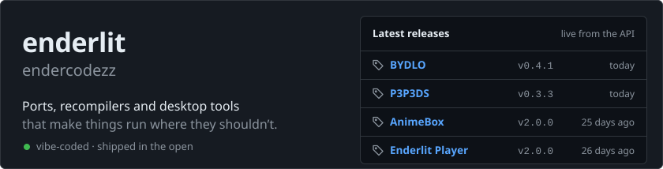
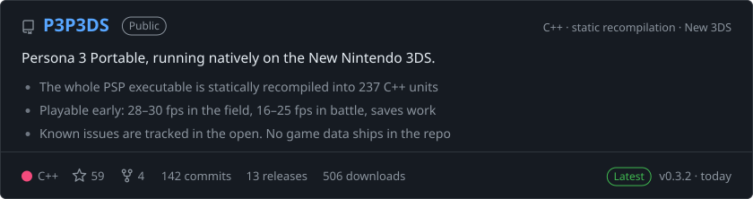
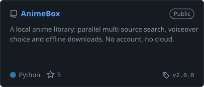
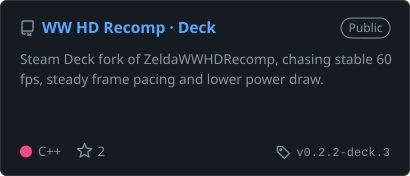
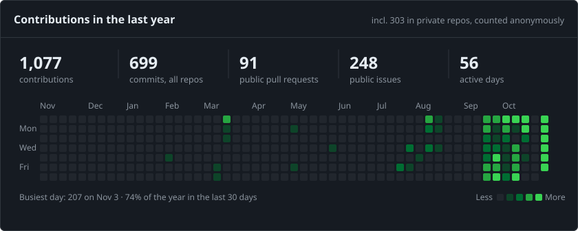
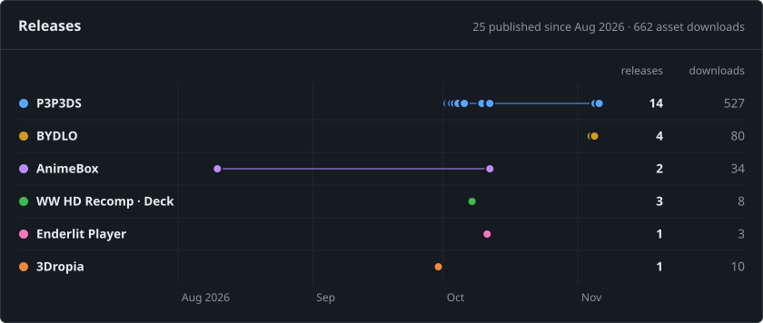
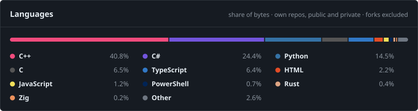
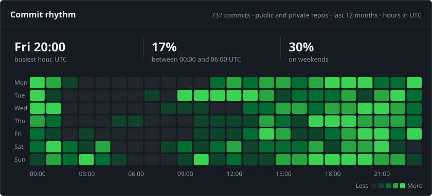

<a href="https://enderlit.com"><picture><source media="(prefers-color-scheme: dark)" srcset="assets/header-dark.svg"><source media="(prefers-color-scheme: light)" srcset="assets/header-light.svg"></picture>
</a>

  <a href="https://enderlit.com"><b>enderlit.com</b></a>&nbsp;&nbsp;·&nbsp;&nbsp;<a href="https://t.me/enderlit"><b>Telegram</b></a>&nbsp;&nbsp;·&nbsp;&nbsp;<a href="https://github.com/endercodezz?tab=repositories"><b>All repositories</b></a>

I like making software run where it was never meant to: a PSP game on a New 3DS, Wind Waker HD tuned for a Steam Deck, eleven VPN and proxy protocols behind one button. Most of my code is written together with AI agents. Every release lists its known issues, measured numbers and what is still broken.

## Featured

<a href="https://github.com/endercodezz/P3P3DS"><picture><source media="(prefers-color-scheme: dark)" srcset="assets/card-p3p3ds-dark.svg"><source media="(prefers-color-scheme: light)" srcset="assets/card-p3p3ds-light.svg"></picture></a>

<a href="https://github.com/endercodezz/BYDLO"><picture><source media="(prefers-color-scheme: dark)" srcset="assets/card-bydlo-dark.svg"><source media="(prefers-color-scheme: light)" srcset="assets/card-bydlo-light.svg"></picture></a>

## Also shipping

  <a href="https://github.com/endercodezz/AnimeBox"><picture><source media="(prefers-color-scheme: dark)" srcset="assets/card-animebox-dark.svg"><source media="(prefers-color-scheme: light)" srcset="assets/card-animebox-light.svg"></picture></a>
  <a href="https://github.com/endercodezz/ZeldaWWHDRecomp-Deck"><picture><source media="(prefers-color-scheme: dark)" srcset="assets/card-zeldawwhdrecomp-deck-dark.svg"><source media="(prefers-color-scheme: light)" srcset="assets/card-zeldawwhdrecomp-deck-light.svg"></picture></a>
  <a href="https://github.com/endercodezz/enderlitplayer"><picture><source media="(prefers-color-scheme: dark)" srcset="assets/card-enderlitplayer-dark.svg"><source media="(prefers-color-scheme: light)" srcset="assets/card-enderlitplayer-light.svg"></picture></a>
  <a href="https://github.com/endercodezz/3Dropia"><picture><source media="(prefers-color-scheme: dark)" srcset="assets/card-3dropia-dark.svg"><source media="(prefers-color-scheme: light)" srcset="assets/card-3dropia-light.svg"></picture></a>

## By the numbers

<picture><source media="(prefers-color-scheme: dark)" srcset="assets/activity-dark.svg"><source media="(prefers-color-scheme: light)" srcset="assets/activity-light.svg"></picture>

<picture><source media="(prefers-color-scheme: dark)" srcset="assets/shipping-dark.svg"><source media="(prefers-color-scheme: light)" srcset="assets/shipping-light.svg"></picture>

<picture><source media="(prefers-color-scheme: dark)" srcset="assets/languages-dark.svg"><source media="(prefers-color-scheme: light)" srcset="assets/languages-light.svg"></picture>

<picture><source media="(prefers-color-scheme: dark)" srcset="assets/rhythm-dark.svg"><source media="(prefers-color-scheme: light)" srcset="assets/rhythm-light.svg"></picture>

<!-- numbers:start -->

The same numbers as text

| | |
|---|---|
| Last year | 981 contributions (incl. 303 private, counted anonymously) on 55 active days |
| Breakdown | 658 commits across public and private repos · 76 public pull requests · 216 public issues |
| Releases | 24 published since Aug 2026 · 592 asset downloads |
| Commit rhythm | busiest hour Tue 15:00 · 29% between 00:00 and 06:00 · 34% on weekends |
| Languages | C++ 47.0% · C# 18.3% · Python 15.3% · C 5.6% · TypeScript 5.2% · Objective-C++ 3.2% · HTML 1.8% · JavaScript 1.0% · Other 2.6% |

Generated 2026-11-05 00:36 UTC from the GitHub API.

<!-- numbers:end -->

## Toolbox

**Languages:** C++ · C# · Python · TypeScript · C 
**Frameworks:** .NET / Avalonia · Qt · FastAPI · React + Vite 
**Builds:** CMake · devkitARM · GitHub Actions CI and releases 
**Targets:** Windows · Linux · macOS · New Nintendo 3DS · Steam Deck

Every chart on this page is redrawn daily by <a href=".github/workflows/refresh.yml">a workflow in this repo</a> from the GitHub API. No time trackers and no third-party stat services. Private repositories count toward the totals and are never named.
